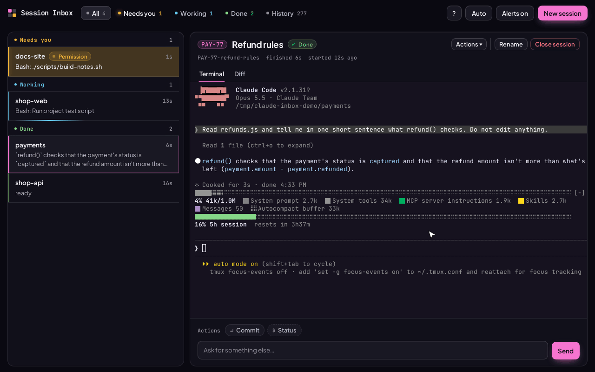
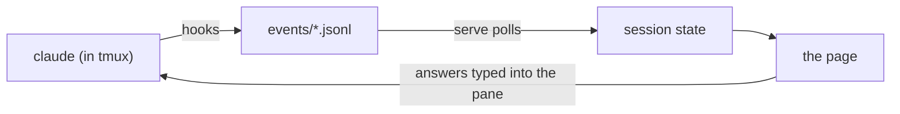
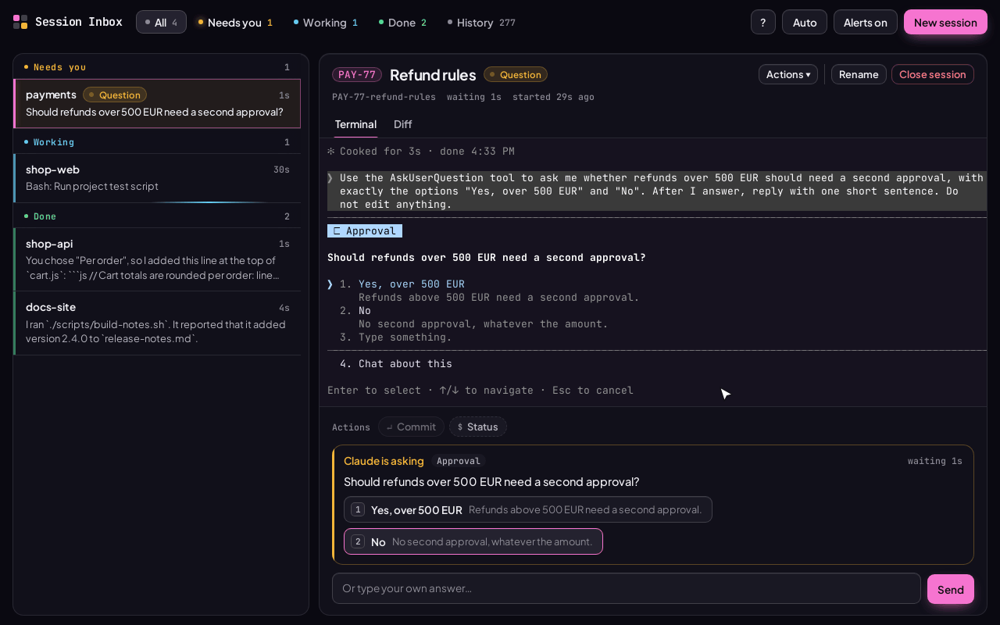
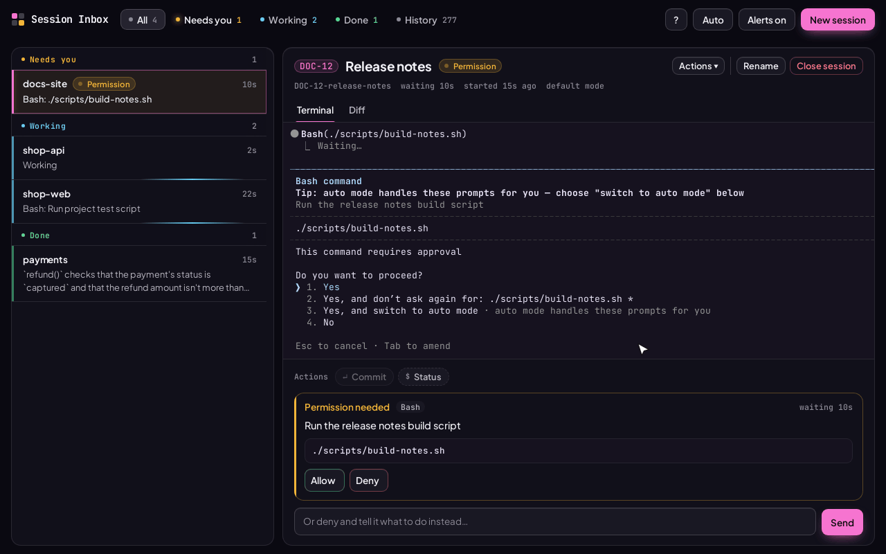
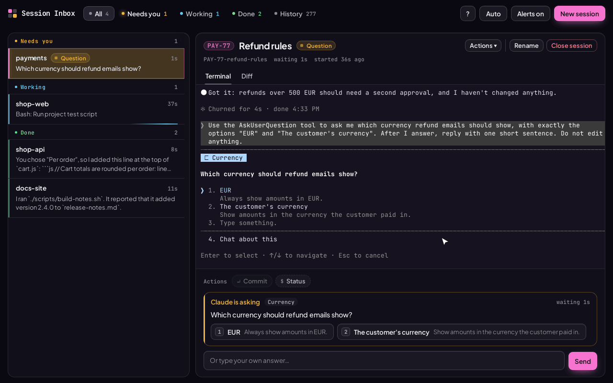
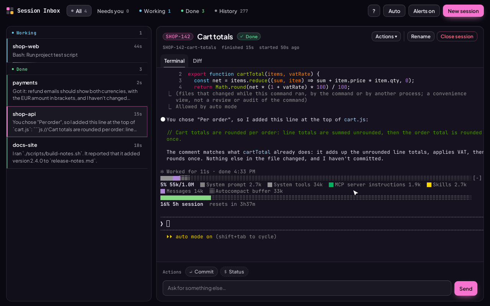
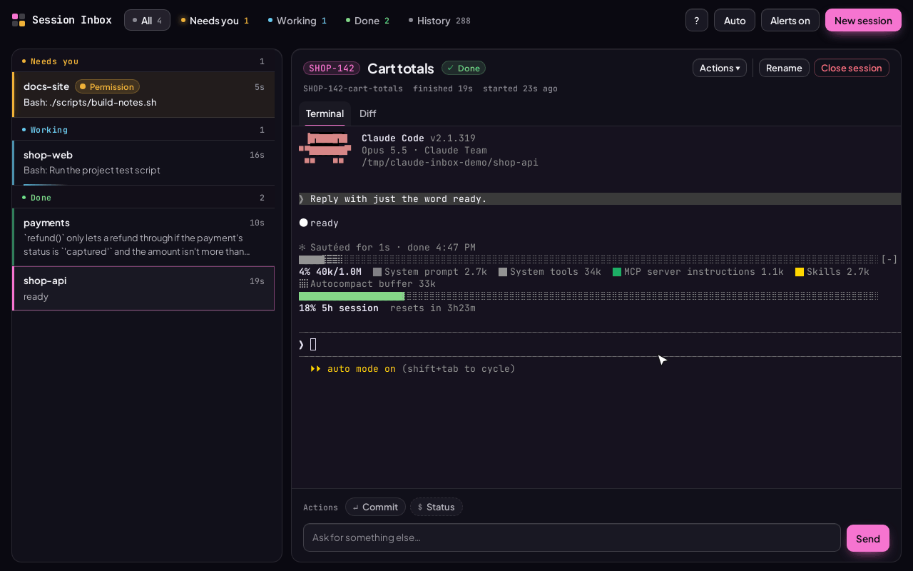
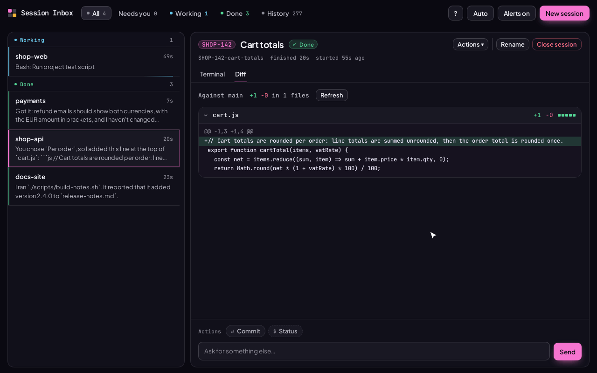

# Session Inbox

Run many Claude Code sessions at once and answer the ones that are waiting, from one window.



## What it is

A local web app that lists every Claude Code session on your machine, with the ones waiting on a question or a
permission at the top. You answer them, watch their live terminal and read their diff without leaving the page,
and a desktop alert fires when a session starts waiting.

Claude Code keeps running in a real terminal: each session runs inside tmux, and the app types your answers into
its pane. You never have to use tmux yourself.

## Why

Five sessions in five terminal tabs, and three of them are blocked — but nothing tells you which, or for how long.
You cycle through tabs to find out, and lose your place in each one.

The inbox turns that into a queue: blocked sessions on top, with their question in the row, answerable with one
click. Nothing about how you run Claude Code changes, and nothing is wrapped or reimplemented — the app drives
the same terminal you would.

## How it works



A Claude Code hook appends every event to the state directory. `serve` polls those files, turns them into each
session's state, and sends it to the page. Your answer goes back as key presses in the session's tmux pane.

Nothing is held in memory only: stop `serve` and the sessions keep running, start it again and it rebuilds their
state from the recorded events. Details in [docs/architecture.md](docs/architecture.md).

## Quick start

Needs Linux or macOS with `tmux`, `git` and `claude` on `PATH`.

```bash
go install github.com/bogdanlinitskiy/claude-inbox/cmd/claude-inbox@latest
```

```bash
claude-inbox setup    # optional: also list the sessions you start yourself
```

```bash
claude-inbox serve
```

Open the link it prints. Other install paths, the Docker build and what `setup` writes:
[docs/install.md](docs/install.md).

## What you get

- **An inbox** — Needs you, Working, Done; each row with its repository, branch, state and how long it has been
  in it. Sessions on one ticket sit together.
- **Answers in the app** — option buttons and free text for questions, Allow / Deny for permissions, a message box
  and Interrupt while Claude works.

  

  

  

- **Terminal and diff** — the live tmux pane, and `git diff` against the merge base with the default branch.

  

- **New sessions** — pick a repository, a ticket and a first message, optionally in a fresh git worktree.

  

- **Your own buttons** — chips and a searchable menu that type a prompt into a session or run a shell command in
  its folder.

  

- **History and alerts** — past conversations from Claude Code's transcripts, searchable and resumable, and a
  desktop notification the moment a session starts waiting.

## Docs

| | |
|---|---|
| [install.md](docs/install.md) | Requirements, install, the global hook, `claude-tmux` |
| [guide.md](docs/guide.md) | The app itself: list, answering, tabs, history, keyboard |
| [configuration.md](docs/configuration.md) | `config.json`, every key and flag, embedding |
| [repositories.md](docs/repositories.md) | Which repositories the start form offers (`roots`, `repo_groups`) |
| [actions.md](docs/actions.md) | Your own buttons: `primary_actions`, `secondary_actions` |
| [security.md](docs/security.md) | What protects the app, and what `run` actions can do |
| [development.md](docs/development.md) | Make targets and tests |
| [architecture.md](docs/architecture.md) | How it works inside |

## Security

The app can type into sessions that run commands on your machine, so anyone who can use it has a shell. It listens
on 127.0.0.1 only and every request needs the per-run token from the login link. Never expose the port, and do not
share the link. More: [docs/security.md](docs/security.md).

## License

MIT, see [LICENSE](LICENSE). The vendored xterm.js is MIT too (`web/vendor/LICENSE-xterm`).
