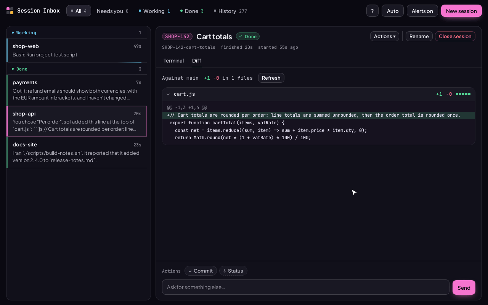

# Your own actions

Actions are your own buttons for the selected session. One types a prompt or a slash command into it, the other
runs a shell command in its folder and shows you the output.



They live in `~/.config/claude-inbox/config.json`, in two lists:

- `primary_actions` become chips over the reply box, two rows at most; the rest sit behind a "+N more" chip that
  opens them in a searchable list.
- `secondary_actions` fill the Actions menu in the session header (or press <kbd>.</kbd>), which opens with its
  search box focused.

Both take the same entries, an action may be in both, and neither has a size limit.

```json
"primary_actions": [
  {"label": "Commit", "send": "Commit the changes made during this session"},
  {"label": "Ultracave", "send": "/ultracave"},
  {"label": "Ticket…", "send": "Work on {input}", "input": "Ticket id"}
],
"secondary_actions": [
  {"label": "Pull", "run": "git pull --ff-only", "confirm": true},
  {"label": "Switch branch", "run": "git switch \"$INBOX_INPUT\"", "input": "Branch"}
]
```

## Entries

Each entry has a `label` and exactly one of `send` or `run`:

**`send`** — text typed into the session as a prompt, exactly as the reply box does it, so a slash command works
too. Available while the session is idle, finished or working (a working session reads it after the current step),
not while it waits on a question.

**`run`** — an `sh` command run in the session's folder, not seen by Claude. Its output and exit code show in a
notice. Refused while the session is working, so it cannot race Claude's edits, and stopped after 5 minutes.

## Asking for one line

`input` asks for one line before acting, with the given text as its label:

- a `send` puts the answer where `{input}` is;
- a `run` gets it in `$INBOX_INPUT`, never pasted into the command.

`confirm: true` asks for a second click first.

A malformed entry stops `serve` with the name of the entry.

## A note on run

A `run` action executes whatever you put in it, with your own permissions. The page can only pick an action by its
place in the list — it can never send a command of its own — but anyone who can open the app can trigger every
`run` you configured. See [security.md](security.md).
