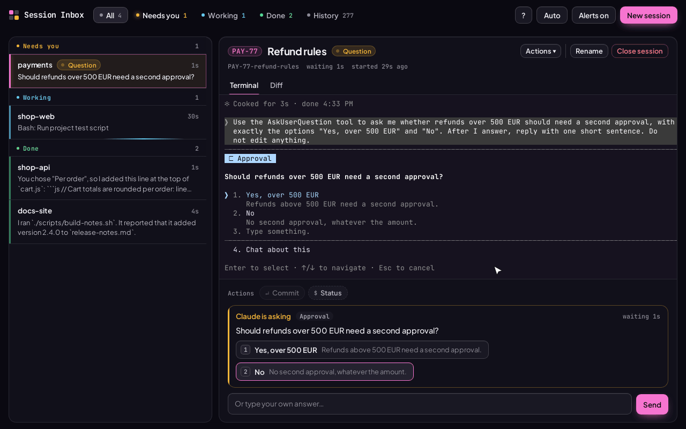
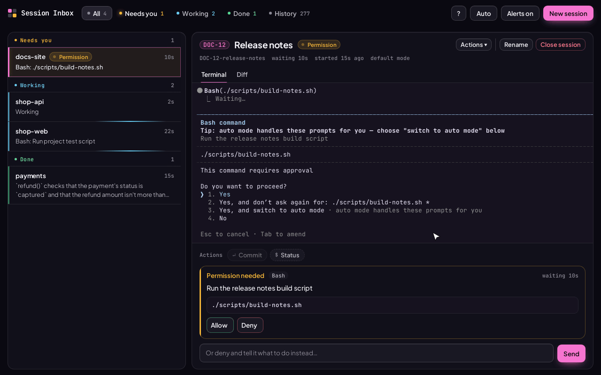
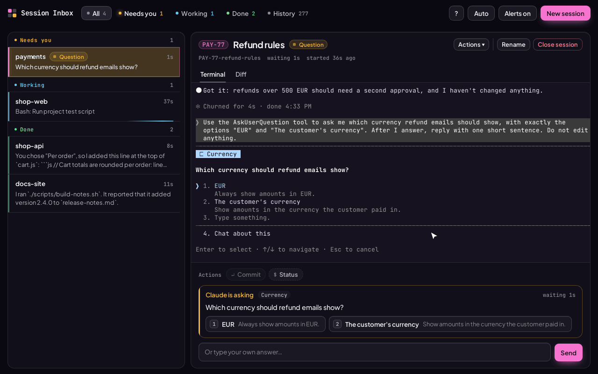

# Using the app

Start it and open the link it prints:

```bash
claude-inbox serve
```

`--open` opens it in the default browser. The link is also saved to `~/.local/state/claude-inbox/serve.url`, so
another local tool can open the app without the printed link.

## The list

Three blocks, always in this order:

- **Needs you** — a session waiting on a question, a permission, a folder it does not trust, or something the app
  does not recognize. The row shows the question, or the command Claude wants to run.
- **Working** — Claude is busy. The row shows what it is doing.
- **Done** — finished or idle, with the last message.

Every row carries its repository, branch, state and how long it has been in that state. The filters in the header
(All, Needs you, Working, Done) narrow the list; the counts next to them are live.

Sessions whose branch holds the same ticket id sit together inside their block. Click the ticket chip on a row, or
press <kbd>t</kbd>, to narrow the list to that ticket and see how its sessions are split across the three states;
press <kbd>t</kbd> again to clear it. Which id counts as a ticket is set by `ticket_pattern`, see
[configuration.md](configuration.md).

## Answering

The reply box under the selected session changes with its state:

| State | What you get |
|---|---|
| Question | The option buttons Claude offered, and free text |
| Permission | Allow / Deny |
| Untrusted folder | Trust / Don't trust |
| Working | A message box (Claude reads it after the current step) and Interrupt |
| Idle or finished | A message box |

An option, a permission, and an answer in your own words:







Your own buttons sit above the reply box and in the Actions menu, see [actions.md](actions.md).

Answers are typed into the session's tmux pane, so Claude sees exactly what it would see from the keyboard.

## Tabs

- **Terminal** — the session's live tmux pane: readable, scrollable and typeable, for anything the app's own
  controls don't cover.
- **Diff** — `git diff` against the merge base with the repository's default branch, including uncommitted and
  untracked files.


The session header also holds Rename, Open in IDE (with `ide` set) and Close.

## Starting a session

**New session** asks for a repository or workspace, a ticket, a title and a first message, and can start the
session in a new git worktree — an existing branch is checked out as it is, a new one starts from the default
branch, and the worktree goes in a folder next to the repository ending in `-worktrees`, where it stays after the
session closes.


Claude starts in auto mode, in its own tmux session. The repositories Claude ran in before are offered with no
setup at all; to list your own instead, see [repositories.md](repositories.md).

## Sessions you start yourself

With the global hook installed ([install.md](install.md)), sessions started outside the app are listed too. Those
running in tmux — see `claude-tmux` — can be answered like any other; the rest are view-only.

## History

The **History** filter lists past conversations from Claude Code's own transcripts, searchable, with a preview and
a Resume button that starts it again in tmux, where it rejoins the list.

## Alerts

A desktop notification fires when a session starts waiting; clicking it selects that session. **Alerts on** in the
header turns them off. The browser asks for permission the first time.

## Keyboard

<kbd>?</kbd> in the header shows the same list.

| Key | Does |
|---|---|
| <kbd>↑</kbd> <kbd>↓</kbd>, <kbd>j</kbd> <kbd>k</kbd> | Move through the list |
| <kbd>1</kbd>–<kbd>9</kbd> then <kbd>Enter</kbd> | Pick an answer option (the digit only moves to it, so a stray key never answers) |
| <kbd>Enter</kbd> | Jump to the reply box |
| <kbd>Shift</kbd>+<kbd>Enter</kbd> | New line in the reply box |
| <kbd>Esc</kbd> | Leave the reply box |
| <kbd>t</kbd> | Only this ticket, and back |
| <kbd>.</kbd> | The Actions menu |

## Linking to a session

`#session=<id>` in the URL selects that session once it is loaded — useful for another local page that links to
the session waiting on you.

## Restarts

Stopping `serve` leaves the Claude sessions running in tmux. Start it again and it rebuilds their state from the
recorded events.
