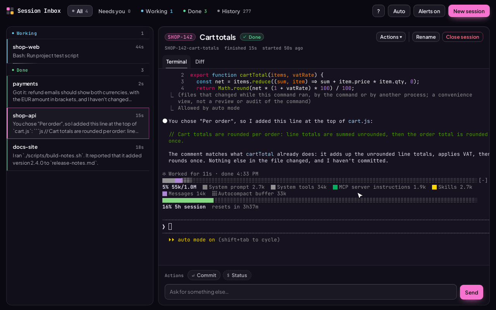
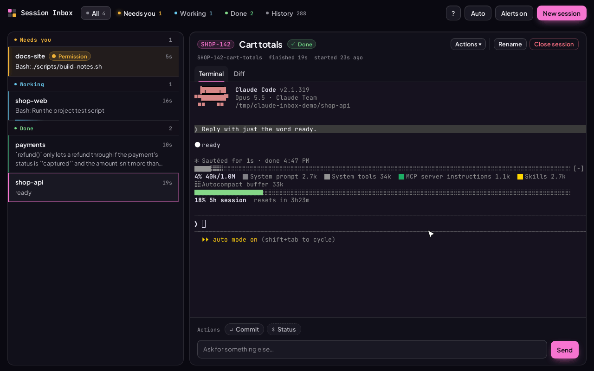

# Using the app

Start it and open the link it prints:

```bash
claude-inbox serve
```

`--open` opens it in the default browser. The link is also saved to `~/.local/state/claude-inbox/serve.url`, so
another local tool can open the app without the printed link.

## The list

The blocks, always in this order:

- **Needs you** — a session waiting on a question, a permission, a folder it does not trust, or something the app
  does not recognize. The row shows the question, or the command Claude wants to run.
- **Pinned** — the sessions you pinned with **Pin** in the session header, whatever their state; each row says
  its state. A pinned session that needs you shows under Needs you until it is answered. **Unpin** puts it back
  in its state block. A session of a group stays in its group and has no Pin.
- **Groups** — one block per group of sessions started together (see
  [Several repositories at once](#several-repositories-at-once)).
- **Working** — Claude is busy. The row shows what it is doing.
- **Done** — finished or idle, with the last message.

A group's sessions stay in its block whatever their state; each row says its own state. The group's header shows
the ticket, the title, the branch and how its sessions are split across the states. While one of them needs you,
the header turns amber and the group moves above the other groups. Click the header to fold the group; a folded
header still turns amber.

Every row carries its repository, branch, state and how long it has been in that state. A row can also be
tagged **from screen**, for a question the app read off the terminal rather than one Claude Code reported; see
[Questions read from the screen](#questions-read-from-the-screen). The filters in the header
(All, Needs you, Working, Done) narrow the list; the counts next to them are live.

Sessions whose branch holds the same ticket id sit together inside their block. Click the ticket chip on a row, or
press <kbd>t</kbd>, to narrow the list to that ticket and see how its sessions are split across the three states;
press <kbd>t</kbd> again to clear it. Which id counts as a ticket is set by `ticket_pattern`, see
[configuration.md](configuration.md).

The filter box at the top of the list narrows it to rows whose repository, branch, ticket, title or text contains
what you type. <kbd>/</kbd> focuses it; <kbd>Esc</kbd> clears it. In History the same box searches past
conversations instead.

## Answering

The reply box under the selected session changes with its state:

| State | What you get |
|---|---|
| Question | The option buttons Claude offered, and free text |
| Permission | Allow / Deny |
| Untrusted folder | Trust / Don't trust |
| Working | A message box (Claude reads it after the current step) and Interrupt |
| Idle or finished | A message box |

An option, a permission, and an answer in your own words:


Your own buttons sit above the reply box and in the Actions menu, see [actions.md](actions.md).

Answers are typed into the session's tmux pane, so Claude sees exactly what it would see from the keyboard.

### Questions read from the screen

Claude Code asks some things without reporting them to the app: a new MCP server, a usage limit, and other
prompts that reach the terminal with no hook behind them. For a session that runs in tmux, the app reads the
screen every couple of seconds while it is quiet, and shows a numbered menu it finds there as a question tagged
**from screen**. Answer it like any other.

Such a question is read from the terminal rather than reported, so it carries less than a normal one: the
options as they are written on the screen, and no description of the tool behind them. If the menu disappears
because you answered it in the terminal instead, the row goes back to what it showed before.

## Tabs

- **Terminal** — the session's live tmux pane: readable, scrollable and typeable, for anything the app's own
  controls don't cover.
- **Diff** — `git diff` against the merge base with the repository's default branch, including uncommitted and
  untracked files. Its buttons:
  - **Commit N files** — asks for a message (it starts with the branch name) and commits exactly the files that are
    uncommitted, untracked ones included, with `git commit -- <paths>`. Refused while Claude is working.
  - **Push** — `git push --set-upstream origin HEAD`, never forced.
  - **Open PR** — pushes, then opens the branch's pull request in a new tab: the open one, or a new draft that `gh`
    fills from the commits. Shown only when `gh` is installed.

  Push and Open PR are not offered on the default branch or a detached HEAD. A rejected hook or push shows git's
  own output.
- **Group** — only for a session of a group: the group's sessions with their state (click one to open it), and
  the messages they sent each other. **Close group** there closes all of them at once (click twice); the worktrees
  and branches stay.



The session header also holds Pin, Rename, Open in IDE (with `ide` set) and Close.

## Starting a session

**New session** asks for a repository or workspace, a ticket, a title and a first message, and can start the
session in a new git worktree — an existing branch is checked out as it is, a new one starts from the default
branch, and the worktree goes in a folder next to the repository ending in `-worktrees`, where it stays after the
session closes.



Claude starts in auto mode, in its own tmux session. The repositories Claude ran in before are offered with no
setup at all; to list your own instead, see [repositories.md](repositories.md).

## Several repositories at once

For a task that changes several repositories, the **Multi** tab of New session starts one session per repository,
as a group. Tick the repositories (the box above the list filters it; the ticked ones stay as chips above it), and
give one ticket. Tick the worktree box to start each session in a new worktree of its repository, on one branch.

A ticked repository shows **− 1 +** on the right: press **+** to start more sessions in it, up to 9, for work that
splits inside one repository; **−** at 1 unticks it. While a repository has more than one session, the coordinator
is on and locked, since it splits the work between them, and the worktree box is off, since they share one folder.

Every session of the group is told, in its system prompt, which other sessions are in the group, where they run,
and how to message them. With **Let the sessions read each other's folders** each one can also read the others'
folders (`claude --add-dir`), so a session can check another repository's side of a contract without asking.

With **Add a coordinator**, one more session starts in the folder that holds the repositories. Only it gets the
first message: it splits the task, sends each session its part, answers their questions, collects their reports
and writes you one summary. Without a coordinator, every session gets the first message, and they tell each other
when a change affects another one.

A session messages another one by running `claude-inbox send <name> "<text>"`; the text reaches the other session
as a prompt starting with `[from <sender>]`, and a busy session gets it when its turn ends. Permission prompts of
every session still come to you, never to the coordinator.

Each session is told to report every turn in which it changed something, also one you started by typing to it
directly. The app does not rely on that alone: it messages the coordinator itself, as `[from claude-inbox]`, when a
session ends a turn without reporting it, stops on an error, ends, or goes silent. A session of a group that has
been working for 5 minutes without any sign of activity may have lost its connection, which Claude Code does not
report; it shows **No activity**, counts as needing you (its group header turns amber, and you get an alert), and
the coordinator is told. Any activity clears it.

## Sessions you start yourself

With the global hook installed ([install.md](install.md)), sessions started outside the app are listed too. Those
running in tmux — see `claude-tmux` — can be answered like any other; the rest are view-only.

## History

The **History** filter lists past conversations from Claude Code's own transcripts, searchable, with a preview and
a Resume button that starts it again in tmux, where it rejoins the list. The search box matches the title, the
first prompt, the title the page gave the session that held the conversation, the repository, ticket, branch and
folder.

## Alerts

A desktop notification fires when a session starts waiting; clicking it selects that session. **Alerts on** in the
header turns them off. The browser asks for permission the first time.

**Sound off** in the header turns on a short two-note sound with each alert, for when you are away from the
screen. It is off by default and stays as you set it. After a reload, the browser allows sound only once you have
clicked or pressed a key on the page.

A screen reader hears how many sessions need you each time that number changes.

## Keyboard

<kbd>?</kbd> in the header shows the same list.

| Key | Does |
|---|---|
| <kbd>↑</kbd> <kbd>↓</kbd>, <kbd>j</kbd> <kbd>k</kbd> | Move through the list |
| <kbd>1</kbd>–<kbd>9</kbd> then <kbd>Enter</kbd> | Pick an answer option (the digit only moves to it, so a stray key never answers) |
| <kbd>Enter</kbd> | Jump to the reply box |
| <kbd>Shift</kbd>+<kbd>Enter</kbd> | New line in the reply box |
| <kbd>Esc</kbd> | Leave the reply box |
| <kbd>t</kbd> | Only this ticket, and back |
| <kbd>.</kbd> | The Actions menu |
| <kbd>/</kbd> | Filter the list; <kbd>Esc</kbd> clears it |

## Linking to a session

`#session=<id>` in the URL selects that session once it is loaded — useful for another local page that links to
the session waiting on you.

## Restarts

Stopping `serve` leaves the Claude sessions running in tmux. Start it again and it rebuilds their state from the
recorded events.
